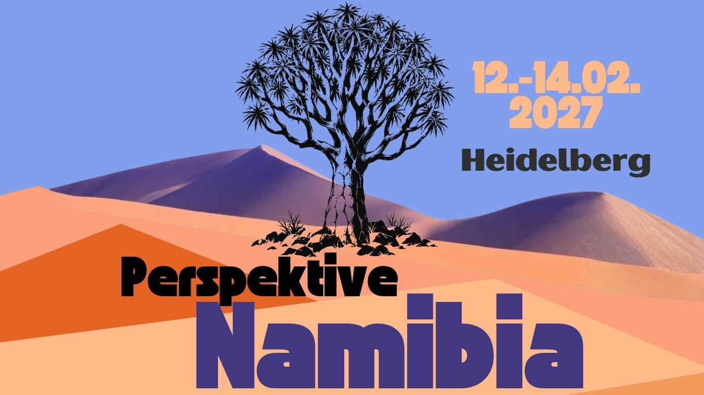

<figure>

</figure>

<a href="https://www.instagram.com/perspektive_widerstand/">
        
            <i class="icon-instagram"></i>
        
        Instagram
   </a>

Von deutschem Kolonialismus und Völkermord bis zu neokolonialer Ausbeutung: Über Generationen des Widerstands der Ovaherero und Nama, den Kampf um Ressourcen, Selbstbestimmung und Klimagerechtigkeit und die Frage, was Versöhnung und Wiedergutmachung nach einem Genozid bedeutet.

Dazu erwarten uns spannende Vorträge und Workshops von Aktivist*innen, Künstler*innen und Wissenschaftler*innen. Insbesondere wollen wir aber natürlich den Stimmen aus Namibia selbst zuhören.

<b>Wann: 12. bis 14. FEBRUAR 2027 
Wo: COLLEGIUM ACADEMICUM, HEIDELBERG</b>

<!--<blockquote>-->
<!--<cite>Lasst uns gemeinsam demokratische Zukunftsvisionen und Perspektiven für Frieden und Gerechtigkeit entwickeln!</cite>-->
<!--</blockquote>-->

<a class="button is-primary"
href=""
style="font-weight:bold; width:20em">Hier geht's bald zur Anmeldung</a>

In den kommenden Wochen halten wir euch hier über das Programm auf dem Laufenden! Für Schlafmöglichkeiten, sowie leckeres Essen wird gesorgt – auch hier folgen bald weitere Infos.

