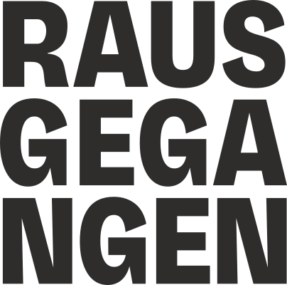

Eine aktuelle Übersicht über kommende Veranstaltungen bei uns findest du in der Tabelle unten und zum Teil auf:

    <a href="https://rausgegangen.de/locations/aula-des-collegium-academicum/">
    &nbsp;&nbsp;&nbsp;
    <a href="https://rausgegangen.de/organizations/collegium-academicum/" class="button is-medium is-primary">
        
            <i class="icon-link"></i>
        
        rausgegangen.de
    </a>

Datum | Veranstaltung 
-------- | -------- 
**November 2026** |
Do, 19.11., 19:00-20:30 | <a href="https://calendar.boell.de/de/event/autoritaere-rebellion-6">Lesung und Gespräch</a> mit dem Autor Andreas Speit: "Autoritäre Rebellion" (Heinrich Böll Stiftung BW, Collegium Academicum, Heidelberger Bündnis "Kein Schritt nach rechts") - Eintritt frei
Sa, 28.11. | <a href="https://www.instagram.com/p/DWgb3mQCIfc/">Zine Fair Heidelberg</a> (Solarpunk Heidelberg & Queerfeministisches Kollektiv Heidelberg)
**Februar 2027** |
12.02. - 14.02. | <a href="https://collegiumacademicum.de/namibia/">Perspektive Widerstand: Namibia</a>
